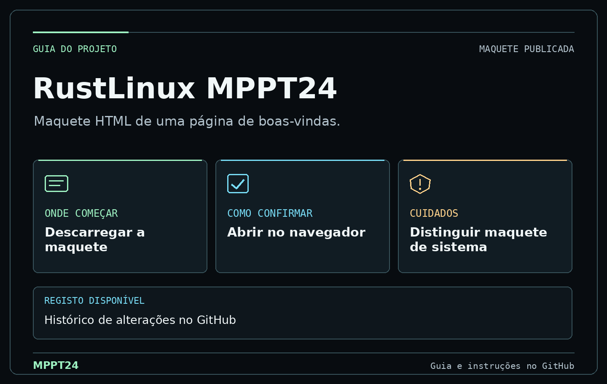

# Guia de RustLinux MPPT24

**Estado:** Maquete publicada.

Maquete HTML de uma página de boas-vindas.

## Onde começar

Abre o [README](README.md) e segue a ligação para a maquete HTML.

## Como confirmar

Descarrega a página e abre-a no navegador. O conteúdo é uma demonstração visual.

## Como ler os registos

A maquete não produz registos de instalação. Se a página falhar, anota o navegador utilizado e o que aconteceu.

Para localizar uma alteração, usa a data e a mensagem do commit no histórico Git.

## Cuidados

Confirma o estado de cada módulo antes de tratar uma maquete como uma distribuição instalável.
